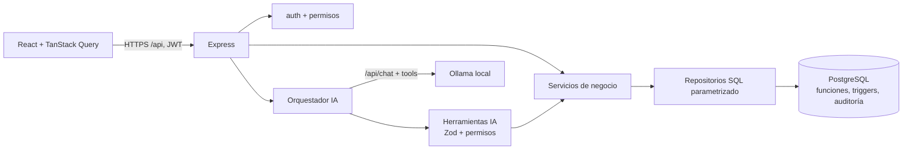

# Arquitectura

- **PostgreSQL** aplica las reglas críticas (no negativos, código único, conversiones, períodos cerrados, roles de tercero,
  vencimiento/garantía, documentos inmutables, auditoría), tal como pide el documento de diseño, para que se cumplan
  también en sincronización, integración y migración.
- **Servicios** orquestan transacciones (`withTransaction` fija `app.usuario_id` y `app.origen` para la auditoría).
- **Ollama** solo es accesible desde el backend; no recibe credenciales ni puede ejecutar SQL.

## Módulos del backend (`backend/src/modules`)

| Módulo | Responsabilidad | Requisitos |
|---|---|---|
| auth | Login, refresh rotado, logout, perfil | RF-SEG-001 |
| admin | Usuarios, roles/permisos, auditoría, cierres (+ tarea programada) | RF-SEG-002, RF-AUD-001, RF-CIE-001 |
| catalogs | Marcas, categorías, unidades | RF-CAT-001 |
| products | Productos, conversiones, ficha técnica, lector | RF-PRO-001..003, RF-LEC-001 |
| inventory | Existencias por estado, agotados, stock mínimo, lotes, kardex, cambio de estado | RF-EST-001, RF-LOT-001, RF-MOV-001 |
| thirdparties | Clientes y proveedores | RF-TER-001 |
| purchases / sales | Documento de ingreso y factura, anulación | RF-COM-001, RF-VEN-001, RF-DOC-001 |
| prices | Historial, precio manual, porcentaje | RF-PRE-001, RF-PRE-002 |
| reports | Dashboard y reportes R-01…R-08 | RF-REP-001 |
| imports | Excel → staging → carga | RF-MIG-001 |
| integration | Eventos externos y ventas offline idempotentes | RF-INT-001, RF-OFF-001 |
| quotations | Cotizador de pintura y cotizaciones | (prompt §7) |
| ai | Cliente Ollama, herramientas, orquestador, conversaciones | (prompt §5) |

Cada módulo separa rutas (con controladores delgados), servicio, repositorio y esquemas Zod. En módulos pequeños
(catálogos, terceros, precios, administración) las consultas viven junto a las rutas para no crear capas vacías.

## Matriz de trazabilidad

| Requisito / regla | Tablas y funciones | Endpoints | Pruebas |
|---|---|---|---|
| RF-SEG-001, RN-18 | usuario, sesion_refresh | POST /auth/login, /refresh, /logout | api-core «Autenticación…» |
| RF-SEG-002 | usuario_rol, rol_permiso | /users, /roles, /permissions | api-core «el administrador crea usuarios…» |
| RF-CAT-001 | marca, categoria, unidad_medida | /brands, /categories, /units | api-core «registra marcas…» |
| RF-PRO-001, RN-01 | producto (UNIQUE codigo_barras) | POST /products | PB-04, api-core «rechaza código duplicado…» |
| RF-PRO-002, RN-05 | unidad_conversion, fn_convertir_a_base | POST /products/:id/conversions | PB-09/10, «compra por cajas…» |
| RF-PRO-003, RF-LEC-001 | vistas sobre existencia y precio_historial | GET /products, /products/barcode/:c | «busca por términos y por código» |
| RF-TER-001, RN-11, RN-17 | tercero (CHECK), fn_validar_rol_tercero | /third-parties | PB-05, PB-12/13, «Terceros» |
| RF-COM-001, RN-12 | compra, compra_detalle, lote, fn_aplicar_entrada_compra | POST /purchases | PB-01, PB-11, «si una línea falla…» |
| RF-VEN-001, RN-10, RN-13 | venta, venta_detalle, fn_aplicar_salida_venta, FIFO | POST /sales | PB-02/03/18, «ventas concurrentes» |
| RF-DOC-001, RN-06 | fn_anular_documento, fn_proteger_documento | POST /purchases|sales/:id/void | RN-06, «anula una venta…» |
| RF-EST-001, RN-03/04 | fn_cambiar_estado_existencia | POST /inventory/state-transfers | PB-07/08, «cambio de estado…» |
| RF-LOT-001, RN-09 | lote, fn_validar_detalle_compra | GET /inventory/lots | PB-11 |
| RF-PRE-001/002, RN-14 | precio_historial, fn_registrar_precio_manual, fn_actualizar_porcentaje | /prices/* | PB-14, «33.750», «precio manual…» |
| RF-CIE-001, RN-08 | cierre_mensual(_detalle), fn_ejecutar_cierre_mensual | /closures | PB-15, «cierre: guarda fotografía…» |
| RF-MOV-001, RN-02 | movimiento_inventario, fn_verificar_kardex | GET /inventory/movements | «kardex… cuadra» |
| RF-REP-001 | consultas R-01…R-08 | /reports/* | «reportes: valorización…» |
| RF-AUD-001, RN-15, RNF-SEG-002/003 | auditoria, fn_auditar, fn_proteger_inmutable | GET /audit | PB-06, PB-16 |
| RF-MIG-001 | importacion, staging_*, fn_aplicar_saldo_inicial | /imports | «importa desde Excel…» |
| RF-OFF-001, RF-INT-001, RN-16 | integracion_evento, venta.uuid_offline | /integration/* | PB-17, «offline… una sola vez», «evento repetido» |
| Agente IA | ia_conversacion, ia_mensaje | /ai/* | ai.test.ts (17 casos) |
| Cotizaciones | producto_ficha_tecnica, cotizacion(_detalle) | /quotations/* | quotations.test.ts, paint-calculator.test.ts |
